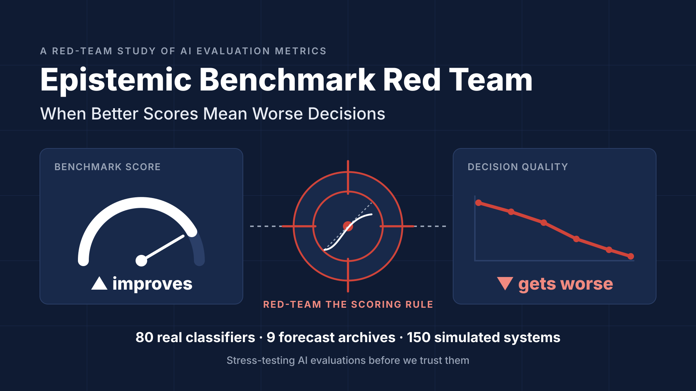
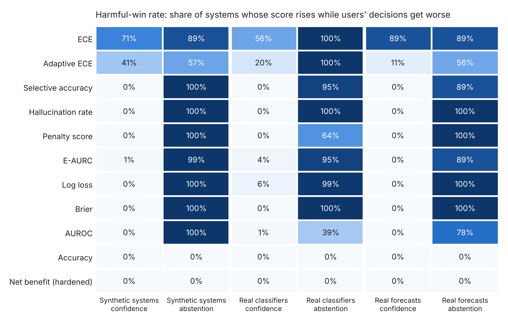

# Epistemic Benchmark Red Team: When Better Scores Mean Worse Decisions



**A benchmark red-team framework that tests whether epistemic evaluation scores can be improved without improving downstream decisions.**

Entry for the Apart Research AI x Epistemics Research Sprint (November 2026), Track 1.
Author: Israt Jahan Aunika, Montclair State University.

- Paper: [`report/report.pdf`](report/report.pdf)
- Supplement (full tables and definitions): [`report/supplement.pdf`](report/supplement.pdf)
- Slides: [`slides/slides.pdf`](slides/slides.pdf)

## The question

Benchmarks that score an AI system's calibration, honesty or caution shape what developers optimise. Can those scores go up while the decisions of the people relying on the system get worse?

Two tricks show the problem. Report the same confidence for every answer, and the standard calibration metric says you are nearly perfect. Refuse every question you might get wrong, and your accuracy on the questions you answer looks superb. Neither changes a single answer.

## What this repository contains

The **Epistemic Benchmark Integrity Test**: an attacker edits only a system's stated confidence, or which questions it declines, and never an answer. Each exploit is tuned on one half of the data and judged on the held-out half. The benchmark's score gain is compared with the change in downstream decision quality.

- **Integrity Gap:** score gain minus decision-quality gain.
- **Harmful win:** the score goes up while decisions get worse.
- **Integrity Profile:** a score's manipulability, harmful-win rate, responsiveness to real improvement, agreement with decision value, and sensitivity to question mix.

Scope of the audit:

| | |
|:--|:--|
| Systems | 80 real classifiers, 9 real forecast archives, 150 simulated systems |
| Scores audited | 10 in common use (accuracy, selective accuracy, hallucination rate, ECE, adaptive ECE, Brier, log loss, AUROC, E-AURC, penalty score), plus one hardened net-benefit score |
| Exploit families | confidence gaming, strategic abstention, metric shopping, question-mix sensitivity |
| Attacker | 13 hand-made exploits plus a remap optimised directly against each score; tuned on a development split and evaluated on a held-out split |
| Decision yardsticks | threshold users under mixed (primary), low and high stakes; naive users who act on every answer |

## Key findings

| Finding | Real classifiers | Real forecasts | Simulation |
|:--|--:|--:|--:|
| ECE error removed by one constant confidence | 86% | 53% | 87% |
| Systems whose decisions got worse as a result | 56% | 89% | 71% |

- **Strategic abstention** games selective accuracy, hallucination rate, Brier score and log loss for at least 89% of systems in every setting tested.
- **Proper scoring rules** (Brier, log loss) resist confidence-only attacks, but not abstention when unanswered items are dropped from the average.
- **Hardened net-benefit score:** 0% harmful wins under the primary yardstick across all three data sources; worst case 8% under the low-stakes robustness profile.
- **Metric shopping:** in pools of ten simulated systems, the ten standard scores name about three different systems as "best".



## What is and is not claimed

- No language model was evaluated. The findings concern scoring rules, which apply to any system scored by them.
- The individual weaknesses of ECE and of selective metrics are partly known. The contribution is the **red-team framework, the measurements, and the closure test** (a proposed repair must survive the same attack).
- The hardened score is not a new metric. It is a threshold-averaged net-benefit score of a known family (Schervish 1989; Vickers and Elkin 2006; Wu et al. 2026).
- Full limitations are in Appendix A of the paper.

## Reproduce

Requires Python 3.10+ and no GPU. The full audit takes about one minute on a two-core CPU and is deterministic: it reproduces the committed result files exactly.

```bash
pip install -r requirements.txt

# public forecast archive (about 200 MB, not redistributed here)
git clone --depth 1 https://github.com/fivethirtyeight/checking-our-work-data data_raw/538

python run_audit.py      # all analyses            -> results/
python figures.py        # figures                 -> figures/
python build_report.py   # paper source            -> report/report.md
python supplement.py     # supplement source       -> report/supplement.md
```

The classifier datasets (digits, breast cancer, wine) ship with scikit-learn. To rebuild the PDFs: `pandoc report/report.md -o report/report.pdf --pdf-engine=xelatex` (run inside `report/`). To rebuild the slides: `node slides/build_deck.js` (needs `pptxgenjs`; paths inside the script are for the author's build environment).

## Repository structure

```
ebrt/core.py        scores, decision yardsticks, exploits, optimiser
ebrt/data.py        simulated systems, real classifiers, forecast loader
run_audit.py        runs every analysis
figures.py          the three paper figures
build_report.py     writes the paper from results/ (no hand-typed numbers)
supplement.py       writes the supplement from results/
results/            released result tables
figures/            paper figures
report/             paper, supplement and their sources
slides/             slide deck (PPTX, PDF)
media/              project image
docs/               presentation script and submission checklist
```

## Output files

| File | Contents |
|:--|:--|
| `results/integrity_profile.csv` | every score, attacker and data source: gains with 95% bootstrap intervals, harmful-win rates under each yardstick, ranking and responsiveness columns |
| `results/attack.csv` | the attacker's chosen exploit for each system and score, with held-out gains |
| `results/exploit_grid.csv` | every hand-made exploit on every system and score |
| `results/by_exploit.csv` | medians per exploit |
| `results/honest_recalibration.csv` | control: Platt scaling and histogram binning |
| `results/shopping.csv` | metric-shopping pools |
| `results/distribution.csv` | ranking flips under a changed question mix |
| `results/responsiveness.csv` | score response to genuine improvements |
| `results/summary.json` | headline counts |

## Provenance

All code and analysis were produced during the sprint; there is no pre-existing project code. An AI assistant (Claude) was used to write code and draft text. The author is responsible for the content.

## Citation

```
Aunika, I. J. (2026). Epistemic Benchmark Red Team: When Better Scores Mean Worse Decisions.
Apart Research AI x Epistemics Research Sprint.
```
See `CITATION.cff`. Code is released under the MIT License. FiveThirtyEight's data is subject to the terms in its own repository.
